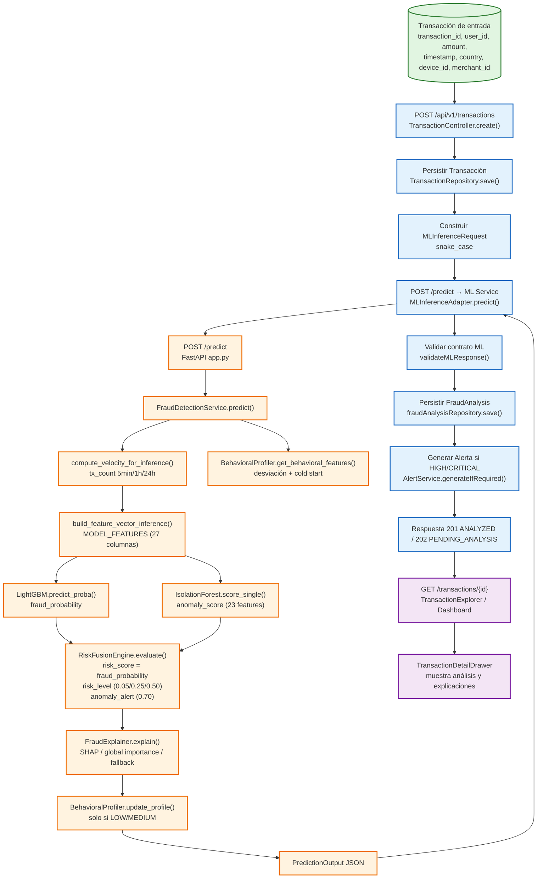

# Arquitectura general

> **Nota:** Esta arquitectura describe el código realmente implementado en el repositorio. No se inventan tecnologías ni servicios (no hay Kafka, sagas, message brokers, ni GNN). La comunicación entre los tres subsistemas es síncrona HTTP (ver `integration-contract-review` skill, regla 7).

## 1. Contexto del sistema

El sistema expone una API RESTful para registrar transacciones de e-commerce y obtener su evaluación de riesgo de fraude. Los tres subsistemas se despliegan como contenedores Docker orquestados por `docker-compose.yml`.

```
┌─────────────────┐      ┌──────────────────┐      ┌─────────────────┐
│   Usuario /     │      │   Backend API    │      │   Base de datos │
│   Analista      │─────►│   (Spring Boot)  │─────►│   PostgreSQL    │
│   (Frontend)    │      │   Puerto 8081    │      │   Puerto 5432   │
└─────────────────┘      └────────┬─────────┘      └─────────────────┘
                                 │
                                 │ HTTP POST /predict
                                 │ (RestTemplate, timeout 2s/5s)
                                 ▼
                          ┌─────────────────┐
                          │   ML Service    │
                          │  (FastAPI)      │
                          │  Puerto 8000    │
                          └─────────────────┘
```

### Servicios y puertos (según `docker-compose.yml`)

| Servicio | Contenedor | Puerto host | Imagen / Build | Depende de |
|---|---|---|---|---|
| `postgres` | `fraud_postgres` | 5432 | `postgres:16-alpine` | — |
| `ml-service` | `fraud_ml_service` | 8000 | `./fraud_detection_ml/Dockerfile` | postgres (healthy) |
| `backend` | `fraud_backend` | 8081 | `./fraud-detection-backend/Dockerfile` (**ausente**) | postgres (healthy) |
| `frontend` | `fraud_frontend` | 5173 | `./fraud-detection-frontend/Dockerfile` (**ausente**) | backend |

**Observación crítica:** `docker-compose.yml` (líneas 41 y 60) referencia los Dockerfiles de backend y frontend, pero esos archivos **no existen** en el repositorio. Solo existe `fraud_detection_ml/Dockerfile`. Esto impide levantar el stack completo con `docker compose up`.

## 2. Diagrama de contenedores (Mermaid)

```mermaid
C4Container
    title Contenedores del sistema ZeroFraudE

    Persona(analista, "Analista de fraude", "Usuario del frontend que consulta transacciones y alertas")
    Persona(cliente, "Cliente e-commerce", "Genera transacciones (vía frontend o API directa)")

    System_Boundary(c1, "ZeroFraudE") {
        Container(frontend, "Frontend Web", "React 19, TypeScript, Vite, Tailwind", "Puerto 5173", "Consulta transacciones, dashboard, alertas")
        Container(backend, "Backend API", "Java 21, Spring Boot 3.3.3, JPA, Flyway", "Puerto 8081", "Orquesta transacción → ML → análisis → alerta")
        Container(ml, "ML Service", "Python, FastAPI, LightGBM, scikit-learn", "Puerto 8000", "Inferencia de fraude: scoring, risk fusion, explainability")
        ContainerDb(db, "Base de datos", "PostgreSQL 16", "Puerto 5432", "Usuarios, transacciones, fraud_analyses, alertas")
    }

    Rel(cliente, frontend, "Registra transacción", "HTTP/JSON")
    Rel(frontend, backend, "API REST (JWT)", "HTTP/JSON")
    Rel(backend, ml, "POST /predict", "HTTP/JSON (RestTemplate)")
    Rel(backend, db, "Persiste transacción, análisis, alerta", "JDBC")
    Rel(analista, frontend, "Consulta dashboard y alertas", "HTTP/JSON")

    UpdateRelStyle(cliente, frontend, "stroke-width: 2px;")
    UpdateRelStyle(frontend, backend, "stroke-width: 2px;")
    UpdateRelStyle(backend, ml, "stroke-width: 2px;")
    UpdateRelStyle(backend, db, "stroke-width: 2px;")
```

## 3. Diagrama de flujo de datos de extremo a extremo (Mermaid)



## 4. Límites entre subsistemas

| Límite | Tecnología | Contrato | Dirección |
|---|---|---|---|
| Frontend → Backend | HTTP/JSON + JWT Bearer | `CreateTransactionRequest` → `TransactionCreateResponse` | Síncrono |
| Backend → ML Service | HTTP/JSON (RestTemplate) | `MLInferenceRequest` → `MLPredictionResult` | Síncrono, timeout 2s/5s, 1 reintento |
| Backend → PostgreSQL | JDBC (Spring Data JPA) | Entidades JPA | Lectura/escritura |
| ML Service → artefactos | Disco local (joblib, pickle) | `fraud_model.joblib`, `behavior_profiles.pkl`, etc. | Solo lectura en inferencia |

**Regla de integración (skill integration-contract-review):** El ML Service no escribe en la base de datos del backend. Cada servicio es dueño de sus datos. El backend valida la respuesta del ML antes de persistirla.

## 5. Despliegue observado vs. esperado

- **Esperado:** `docker compose up -d` levanta los 4 servicios (ver `INFORME_CIERRE_V310.md` pasos para la demo, paso 1).
- **Real:** No se puede verificar porque faltan los Dockerfiles de backend y frontend (referenciados en `docker-compose.yml` pero ausentes). Solo el ML tiene Dockerfile.

## 6. Diagramas adicionales recomendados (pendientes)

El skill `architecture-diagrams` recomienda generar un archivo HTML autocontenido con SVG animado bajo `docs/`. Esto queda como recomendación de documentación visual (no bloqueante). Los diagramas Mermaid de esta sección cumplen la función de documentación estructural inmediata.
