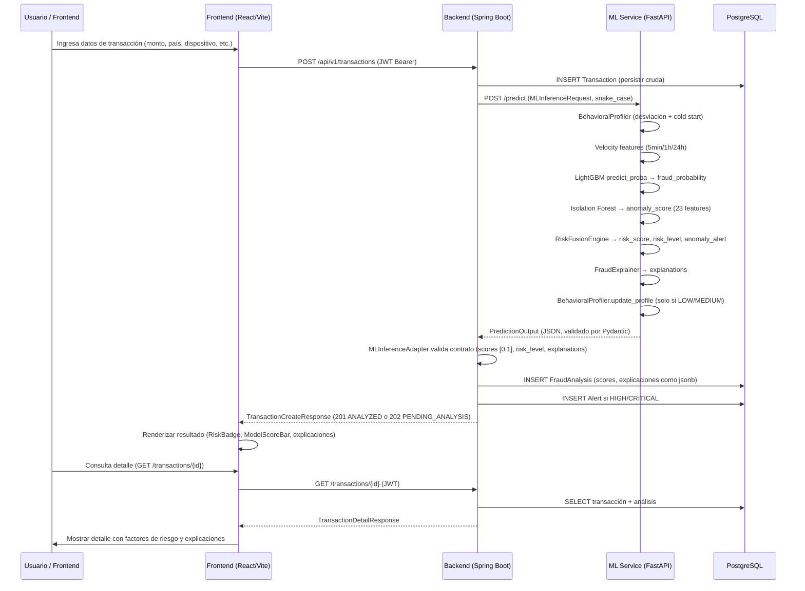

# Integración de extremo a extremo

## 1. Flujo de una transacción desde la entrada hasta la visualización

El flujo sigue la arquitectura síncrona HTTP entre los tres subsistemas (sin message brokers ni sagas, ver `integration-contract-review` regla 7).

## 2. Paso a paso con referencias al código

| Paso | Actor | Acción | Código de referencia |
|---|---|---|---|
| 1 | Frontend | Construir `CreateTransactionRequest` y enviar POST | `TransactionExplorer.tsx`, `DashboardPage.tsx`; `apiClient.ts` |
| 2 | Backend | Recibir en `TransactionController.create()` | `TransactionController.java` L37-51 |
| 3 | Backend | Persistir `Transaction` | `TransactionService.java` L69-78 |
| 4 | Backend | Construir `MLInferenceRequest` | `TransactionService.java` L83-91 |
| 5 | Backend | Llamar ML via `MLInferenceAdapter.predict()` | `MLInferenceAdapter.java` L50-63 |
| 6 | ML | Recibir `POST /predict` | `app.py` L229-261 |
| 7 | ML | Ejecutar `FraudDetectionService.predict()` | `service.py` L128-284 |
| 8 | ML | Retornar `PredictionOutput` | `schemas.py` L120-202 |
| 9 | ML Service | Responder HTTP al backend | `app.py` L229-261 |
| 10 | Backend | Validar contrato (`validateMLResponse`) | `MLInferenceAdapter.java` L101-130 |
| 11 | Backend | Persistir `FraudAnalysis` | `TransactionService.java` L108-119 |
| 12 | Backend | Generar `Alert` si HIGH/CRITICAL | `TransactionService.java` L126, `AlertService` |
| 13 | Backend | Retornar `TransactionCreateResponse` | `TransactionService.java` L131-137 |
| 14 | Frontend | Recibir y renderizar resultado | `TransactionExplorer.tsx`, `DashboardPage.tsx` |
| 15 | Usuario | Consultar detalle | `GET /transactions/{id}` → `TransactionController.getById()` L90-94 |

## 3. Diferencias entre contrato previsto y implementado

### Contrato previsto (según `ml_pipeline_design.md` y plan Kanban CTR-01)

- `risk_score` = fusión ponderada de `fraud_probability`, `anomaly_score` y `behavioral_deviation` (pesos 0.60/0.25/0.15 en el diseño original).
- Umbrales críticos alrededor de 0.85/0.65/0.40 (valores por defecto del constructor `RiskFusionEngine()`).
- Explicaciones SHAP por instancia para transacciones de riesgo.

### Contrato implementado (evidencia real del código)

- `risk_score = fraud_probability` (pesos 1.00/0.00/0.00, v3.1.1) — `configs/risk_fusion.yaml` L16-19, `configs/thresholds.json` L3-5.
- `anomaly_score` es señal separada (`anomaly_alert`, umbral 0.70), no suma a `risk_score` — `src/risk/fusion.py` L125-142.
- Umbrales operativos: critical=0.50, high=0.25, medium=0.05 — `configs/thresholds.json`.
- Explicaciones: SHAP para HIGH/CRITICAL, fallback a feature importance global para LOW/MEDIUM — `shap_explainer.py` L113-120.
- `anomaly_alert` incluido en `PredictionOutput` (añadido en v3.1.1) — `schemas.py` L179-186.

### Diferencias de versión observadas

| Elemento | Valores esperados/documentados | Valores implementados reales | Archivo |
|---|---|---|---|
| `service.load()` default version | "1.0.0" (diseño) | "1.1.0" | `service.py` L63 |
| Versión cargada por `app.py` | — | "3.0.0" | `app.py` L179 |
| `pipeline.yaml` model_version | "1.0.0" | "1.0.0" | `pipeline.yaml` L8 |
| `thresholds.json` versión | "1.0.0" (diseño) | "3.1.1" | `thresholds.json` L2 |
| Umbral critical | 0.85 (diseño original) | 0.50 (v3.1.1) | `thresholds.json` L3 |
| Frontend badge modelo | "LightGBM v1.1.0" | (stale, real es 3.0.0/3.1.1) | `TransactionExplorer.tsx` L77 |

## 4. Campos del contrato ML consumidos vs. no consumidos

Según `integration-contract-review` regla 9:

- `TransactionDetail.explanations` existe en el tipo TypeScript y el MSW mock lo rellena (`mocks/handlers.ts` L49-54). Se debe verificar que `TransactionDetailDrawer` consuma realmente `transaction.analysis.explanations` y no un array hardcoded de `featureWeights`.
- El ML contract expone `explanations: List[str]` (lenguaje natural), no valores SHAP numéricos por feature. El mock muestra datos numéricos de peso por feature; estas son representaciones distintas y no deben confundirse.

## 5. Puntos de fallo y fallback

| Punto | Fallo | Comportamiento implementado |
|---|---|---|
| ML Service no responde | `ResourceAccessException` / `SocketTimeoutException` | `MLUnavailableException` o `MLTimeoutException` con 1 reintento |
| ML respuesta inválida | `InvalidMLResponseException` | Error 500, transacción guardada sin análisis |
| ML timeout | `MLTimeoutException` | 1 reintento tras `retryDelayMs` (default 500ms) |
| ML completamente caído | Cualquier `MLServiceException` | `PENDING_ANALYSIS` (202), transacción persistida sin análisis ni alerta |

El frontend no tiene un fallback específico cuando el backend devuelve 503 por ML caído; muestra el mensaje genérico "El servicio de análisis no está disponible temporalmente" (definido en `apiClient.ts` L76).
